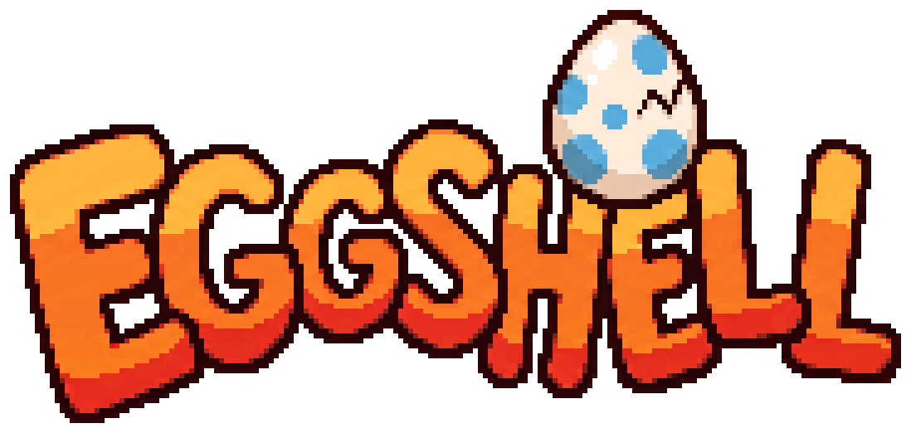

<p align="center">
  
</p>

<p align="center">
  <b>Play YFS levels natively on a Linux handheld.</b>
</p>

Eggshell is backwards compatible with YFS (Yoshi's Fabrication Station). It reads
the JSON level codes that the YFS editor exports and that the community shares.
You do not convert anything. Put the level files in the level folder and pick
one from the level list.

If you have played YFS, you already know how Eggshell plays.

## Compatibility

Measured on 2026-11-03:

| Result | Check |
| ---: | --- |
| 858&nbsp;of&nbsp;858 | Community YFS levels in the test set that load and match the reference build on every tick of a 15-second route |
| 849&nbsp;of&nbsp;854 | Measured levels that hold 60 frames per second on the Anbernic RG35XX Pro |

The game runs a fixed 60 Hz simulation, so a level plays the same on every
screen, at every zoom and with every graphics pack.

## What plays

- Hold jump and your legs keep kicking for a little more height.
- Catch enemies with your tongue and swallow them. Press down to lay an egg.
  Up to six eggs follow you in a line.
- Press L1 to aim and press it again to throw.
- Take a hit and your passenger floats away in a bubble while a countdown runs.
  Catch the bubble before the countdown ends.
- Find the red coins and the flowers. Read the message blocks.
- Eat a melon to spit seeds, fire or ice.
- Ground pound posts into the floor. Swim, ride lifts, roll dice blocks and
  hit switches before the timer ends.
- Masked walkers, winged clouds, stilt walkers, shelled walkers, fish and
  plants that shoot. Many more object families from the editor are in, too.

Every level in the test set plays, but the editor has object variants that no
test level uses. If a level uses one that Eggshell does not know yet, the level
does not start, and the error names the object code.

## Art, music and screenshots

This repository has no art, music, fonts or levels from YFS or from any other
game. That is also why this page has no screenshots.

Eggshell draws with a graphics pack. The repository has one original pack,
Pantry: a chick riding in half an eggshell through a kitchen, at insect scale.
Bread is the ground, and an egg carton is the goal. Pantry draws only part of
the game so far.
The pack format is in [docs/graphics.md](docs/graphics.md).

Levels come from you: the YFS level codes that you made, or that their authors
shared.

## Controls

| Action | Controller |
| --- | --- |
| Move | D-pad |
| Jump, hold to flutter | A or B |
| Tongue or spit | X or Y |
| Aim, then throw | L1 |
| Aim lock | R1 |
| Ground pound, lay an egg | Down |
| Zoom in / out, reset zoom | R2 / L2, R3 |
| Pause | Start |
| Save / load slot | Select + L1 / Select + R1 |
| Quit | Select + Start |

In the level list, the D-pad moves, L1/R1 page, A plays and B goes back. After a goal
the menu offers Next level, Restart level, Levels and Quit.

## Known gaps

- Levels whose music is a web link play no music (275 of 858).
- Five levels drop frames on the RG35XX Pro. The slowest one holds 336 of 600 frames.
- No level editor. Make levels in YFS, then play them here.

## For developers

Eggshell is written in Rust. It draws with OpenGL ES through SDL2 on Wayland.
The target device is the Anbernic RG35XX Pro (Mali-G31, Panfrost).

```sh
# Host build and tests (Linux x86_64).
nix develop ./spikes/rust-stack/player -c cargo test --manifest-path spikes/rust-stack/core/Cargo.toml --release
nix develop ./spikes/rust-stack/player -c cargo test --manifest-path spikes/rust-stack/player/Cargo.toml --lib
# The aarch64 game binary for the handheld.
nix build ./spikes/rust-stack/player#arm64
```

The full gate (`spikes/rust-stack/tools/check-conversion.sh TAG BASE_TAG`) and the
device bundle (`spikes/rust-stack/tools/build-smoke.sh`) run on the build host `aka`.

| Path | What |
| --- | --- |
| `spikes/rust-stack/core` | Simulation: level compile, the step, saves (`v10`), presentation state. |
| `spikes/rust-stack/player` | The game: SDL2 window, GLES drawing, input, audio, menus, level list. |
| `spikes/rust-stack/tools` | Gate, bundle and device scripts. |
| `data/collision_table.json` | Tile collision shapes that every level compile reads. |
| `tests/fixtures` | Original test levels and input routes. |
| `packs/pantry`, `art/pantry` | The Pantry graphics pack and its sources. |
| `art/logo` | The title logo on this page. |
| `docs` | The level code format and the graphics pack format. |
